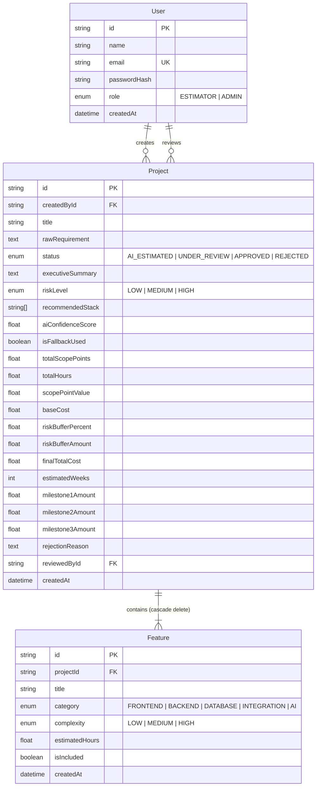

# 🚀 ScopeAI — Intelligent Software Scoping, Costing & Milestone Engine

> **NT TECH INNOVATION — Full Stack Developer Practical Assessment**  
> **Tagline:** Intelligent Software Scoping, Costing & Milestone Engine for Digital Agencies and Engineering Studios.

---

## 📑 Table of Contents
1. [Project Overview & Problem Statement](#-project-overview--problem-statement)
2. [Technology Stack](#-technology-stack)
3. [Test Accounts & Demo Access](#-test-accounts--demo-access)
4. [Database Schema & Architecture](#-database-schema--architecture)
5. [Core Business Logic & Pricing Engine](#-core-business-logic--pricing-engine)
6. [AI / ML Implementation & Fallback Strategy](#-ai--ml-implementation--fallback-strategy)
7. [API Endpoints Reference](#-api-endpoints-reference)
8. [Local Setup & Step-by-Step Execution](#-local-setup--step-by-step-execution)
9. [Automated Testing](#-automated-testing)
10. [Live Demo Walkthrough for Evaluators](#-live-demo-walkthrough-for-evaluators)
11. [Security & Robustness Implementation](#-security--robustness-implementation)

---

## 💡 Project Overview & Problem Statement

### 🔴 The Problem
When software agencies, consultancies, or engineering studios receive unstructured project briefs from prospective clients, estimating the scope manually takes days. Estimators struggle with:
- Breaking down conversational briefs into structured technical deliverables.
- Inconsistent pricing and missed architectural dependencies (e.g., auth, migrations, webhooks).
- Hallucinated or disconnected financial calculations.
- Lack of formal review workflows between junior estimators and senior technical reviewers.

### 🟢 The ScopeAI Solution
ScopeAI is an end-to-end commercial scoping engine:
1. **Intelligent Decomposition:** Translates raw client requirements into categorized, complexity-ranked deliverables (`FRONTEND`, `BACKEND`, `DATABASE`, `INTEGRATION`, `AI`).
2. **Fixed-Scope Valuation:** Calculates transparent, deliverable-based fixed project fees using weighted scope points and contingency risk buffers.
3. **Structured Milestone Scheduling:** Automatically splits the fixed fee into a zero-drift **30% - 40% - 30%** payment roadmap.
4. **Role-Based Workflow State Machine:** Enforces governance between `ESTIMATOR` creation, peer `ADMIN` reviews, rejection reasons, and approved immutability locks.
5. **Client-Ready SOW Proposal:** Generates an executive Statement of Work (SOW) ready for printing or client signature.

---

## 🛠️ Technology Stack

| Layer | Technologies |
| :--- | :--- |
| **Frontend** | **Next.js 16** (App Router, Turbopack, React 19), **TypeScript**, **Tailwind CSS**, **Lucide Icons** |
| **Backend** | **Node.js**, **Express**, **TypeScript**, **Prisma ORM**, **Zod**, **Helmet**, **Morgan** |
| **Database** | **PostgreSQL 16** (Dockerized container) |
| **AI Integration** | **OpenAI API** (`gpt-4o-mini`) & **Google Gemini API**, with an offline deterministic rule-based fallback |
| **Testing** | **Vitest** (Unit test suite covering calculations, fallback rules, and state guards) |

---

## 🔑 Test Accounts & Demo Access

The application comes pre-seeded with two dedicated role accounts. On the `/login` page, you can either click the **Quick Demo Access** buttons to log in with a single click, or enter the credentials manually:

| Role | Email | Password | Permissions & Capabilities |
| :--- | :--- | :--- | :--- |
| **Estimator** | `estimator@scopeai.dev` | `Estimator123!` | Create AI scopes, adjust feature hours, add/delete features, adjust fixed fee, submit to review. |
| **Admin** | `admin@scopeai.dev` | `Admin123!` | Access review queue, conduct peer reviews, approve scopes, or reject with required technical feedback. |

*(Note: In accordance with separation of duty, an administrator cannot review or approve a project that they personally created).*

---

## 🗄️ Database Schema & Architecture

The database is built on **PostgreSQL** managed through **Prisma ORM** with relational integrity and cascade policies:



---

## 🧮 Core Business Logic & Pricing Engine

ScopeAI utilizes a **Fixed-Scope Weighted Valuation Model** instead of raw hourly billing:

### 1. Deliverable Scope Points
Each deliverable is assigned points according to its technical complexity and domain workstream:
$$\text{Scope Points} = \text{Complexity Multiplier} \times \text{Workstream Category Weight}$$

- **Complexity Multipliers:** `LOW` = 1.5 pts | `MEDIUM` = 3.0 pts | `HIGH` = 5.0 pts
- **Workstream Category Weights:** `FRONTEND` = 0.95 | `BACKEND` = 1.10 | `DATABASE` = 1.20 | `INTEGRATION` = 1.25 | `AI` = 1.35

### 2. Base Cost & Risk Contingency
$$\text{Base Cost} = \sum (\text{Active Features Scope Points}) \times \text{Studio Scope Point Value (\$350 USD)}$$
$$\text{Risk Contingency Buffer} = \begin{cases} 5\% & \text{for LOW Risk (Straightforward web tools, landing apps)} \\ 12\% & \text{for MEDIUM Risk (Standard commercial SaaS, booking systems)} \\ 20\% & \text{for HIGH Risk (Healthcare/HIPAA, fintech, real-time streaming, AI pipelines)} \end{cases}$$
$$\mathbf{Final\ Total\ Project\ Cost} = \text{Base Cost} + \text{Risk Buffer Amount}$$

### 3. Payment Milestones (Zero Rounding Drift)
- **Milestone 1 (Kickoff & UI Foundations - 30%):** $\text{round}(\text{Final Cost} \times 0.30)$
- **Milestone 2 (Core Build & Feature Integration - 40%):** $\text{round}(\text{Final Cost} \times 0.40)$
- **Milestone 3 (Testing, Deployment & Handover - 30%):** $\text{Final Cost} - M_1 - M_2$ *(Guarantees exact sum with 0 cent drift)*

### 4. Dynamic Live Recalculation & Overrides
- **Feature Toggling:** Unchecking any feature immediately excludes it from scope, hours, and totals.
- **Fixed Fee Overrides:** Estimators can type any custom fixed project fee (e.g., $10,000 USD) and click `Update project quote`. The system automatically rebalances all individual feature value allocations proportionally.

### 5. State Machine & Governance Guards
- **Guard 1 (Empty Scope):** Rejects submission if `totalHours === 0` or all features are excluded (`400 Bad Request`).
- **Guard 2 (Admin Authorization):** Only `ADMIN` users can approve or reject scopes.
- **Guard 3 (Rejection Feedback):** Rejecting a scope requires a constructive explanation of at least 10 characters.
- **Guard 4 (Approved Immutability):** Once a project is `APPROVED`, all deliverables and fees are permanently locked against editing or deletion (`400 Bad Request`).

---

## 🤖 AI / ML Implementation & Fallback Strategy

### The AI's Role: Chief Software Architect
AI is used for structural intelligence, technical decomposition, and risk categorization—while arithmetic is strictly reserved for the deterministic backend:
1. **Decomposition:** Analyzes plain-text briefs into 6–8 distinct architectural deliverables.
2. **Classification:** Classifies each deliverable's workstream (`FRONTEND` to `AI`) and complexity (`LOW`, `MEDIUM`, `HIGH`).
3. **Effort Prediction:** Predicts realistic engineering effort hours (`estimatedHours`).
4. **Risk Assessment:** Assesses overall project volatility (`LOW`, `MEDIUM`, `HIGH`).
5. **Tech Stack Recommendation:** Curates 4–6 production-grade technologies (e.g., Next.js 15, PostgreSQL, Redis, Stripe).
6. **Executive Summary:** Generates a professional narrative explaining the architecture and delivery path.

### Zero-Downtime Rule-Based Fallback
If the OpenAI or Gemini API is unconfigured, rate-limited, or fails schema validation, ScopeAI automatically switches to an internal **Domain-Aware Heuristic Rule Engine** (`isFallbackUsed: true`):
- Keyword heuristics match specific industries (E-Commerce, Healthcare, Food Delivery, Logistics, Portfolios).
- Generates verified, valid deliverables and realistic risk profiles ensuring 100% offline usability.

---

## 📡 API Endpoints Reference

Base URL: `http://localhost:5001/api/v1`

### Authentication (`/auth`)
- `POST /auth/register` — Register a new estimator account.
- `POST /auth/login` — Authenticate and receive a signed JWT token.
- `GET /auth/me` — Fetch current user profile and role.

### Projects (`/projects`)
- `POST /projects/generate` — AI-powered scope generation from title and raw requirement brief.
- `GET /projects` — Fetch all projects (with optional `?status=` filter; filtered by creator for estimators, global for admins).
- `GET /projects/:id` — Get full project workspace details, features, and milestones.
- `PATCH /projects/:id/status` — Submit for review, approve, or reject (with state guards).
- `PATCH /projects/:id/fee` — Update fixed project quote and recalibrate allocations.
- `DELETE /projects/:id` — Delete a draft project (locked projects cannot be deleted).

### Features (`/projects/:id/features`)
- `POST /projects/:id/features` — Add custom deliverable to scope.
- `PATCH /projects/:id/features/:featureId` — Update deliverable title, hours, or toggle inclusion.
- `DELETE /projects/:id/features/:featureId` — Delete deliverable from scope.

### System & Health
- `GET /` — API server root status and version.
- `GET /health` — Service health check and uptime monitor.

---

## 💻 Local Setup & Step-by-Step Execution

### Prerequisites
- [Node.js](https://nodejs.org/) (v18 or higher)
- [Docker](https://www.docker.com/) & Docker Compose
- Git

### Step 1: Clone Repository & Configure Environment
```bash
# Clone the repository
git clone <your-repo-link>
cd ntTech-ai-scop

# Linux / macOS / Git Bash / PowerShell:
cp backend/.env.example backend/.env
cp frontend/.env.example frontend/.env.local

# Windows Command Prompt (CMD):
# copy backend\.env.example backend\.env
# copy frontend\.env.example frontend\.env.local
```

### Step 2: Start PostgreSQL Database via Docker
```bash
docker compose up -d
# (or from root: npm run db:up)
```
*PostgreSQL container starts on mapped port `5433` (`assessment_db`).*

### Step 3: Install Backend Dependencies & Run Database Seed
```bash
cd backend
npm install
npx prisma generate
npx prisma migrate dev
npm run prisma:seed
cd ..
```
*Seeds the database with the default `estimator@scopeai.dev` and `admin@scopeai.dev` accounts.*

### Step 4: Install Frontend Dependencies
```bash
cd frontend
npm install
cd ..
```

### Step 5: Start Development Servers
Open two terminal windows:

**Terminal 1 (Backend Server — Port 5001):**
```bash
# Option A: From backend directory
cd backend
npm run dev

# Option B: Directly from root directory
# npm run dev:backend
# Server running at http://localhost:5001
```

**Terminal 2 (Frontend Client — Port 3000):**
```bash
# Option A: From frontend directory
cd frontend
npm run dev

# Option B: Directly from root directory
# npm run dev:frontend
# App running at http://localhost:3000
```

> **Root Convenience Scripts:**  
> Once dependencies are installed, you can execute all commands directly from the project root:
> - `npm run db:up` — Start the Dockerized PostgreSQL database.
> - `npm run seed` — Seed initial users and demo projects.
> - `npm run dev:backend` — Launch backend Express server on port 5001.
> - `npm run dev:frontend` — Launch frontend Next.js app on port 3000.
> - `npm run test:backend` — Run Vitest automated test suite.

---

## 🧪 Automated Testing

ScopeAI includes a **Vitest** automated unit testing suite validating the calculation service, AI fallback heuristics, auth validation, and workflow guards:

```bash
# In backend directory
npm test
```

**Test Coverage Highlights:**
- ✅ Fixed-fee calculation and point allocation accuracy.
- ✅ Zero-drift milestone 30/40/30 distribution.
- ✅ State machine guards (empty scope, admin review restrictions, rejection note lengths, approved immutability).
- ✅ Deterministic AI fallback domain relevance and bounds.

---

## 🎬 Live Demo Walkthrough for Evaluators

1. **Step 1: Sign in as Estimator**
   - Go to `http://localhost:3000/login` and click **Login as Estimator**.
   - On the Dashboard, pick a sample blueprint (e.g. *Hospital Management System*) or type your own brief.
   - Click **Build project quote**. Watch the AI create the executive summary, recommended stack, and structured deliverables.
2. **Step 2: Workspace Exploration & Customization**
   - Inspect the KPI summary cards, architecture component distribution, and deliverable breakdown.
   - Toggle an item checkbox off to see live recalculation of total cost, hours, and milestones.
   - Adjust deliverable hours using the `+` / `-` steppers or click to type an exact number.
   - Adjust the **Fixed project quote** (e.g. set to $10,000 USD) and click **Update project quote** to verify proportional reallocation.
   - Click **Submit scope for review** (status transitions to `UNDER_REVIEW`).
3. **Step 3: Sign in as Admin & Review**
   - Log out and click **Login as Admin**.
   - Open the project from the dashboard or review queue.
   - Click **Review scope decisions** to inspect the approval modal.
   - Test the rejection guard by providing feedback, or click **Approve scope**.
   - Notice that once approved, the project displays **Approved & locked** and all editing tools are disabled.
4. **Step 4: Commercial Statement of Work (SOW)**
   - Click **Generate client SOW** to open the professional Statement of Work proposal with formatted deliverables, milestone payment roadmap, and signature section.

---

## 🛡️ Security & Robustness Implementation

- **JWT Authentication:** Strict authorization tokens with configurable expiration (`7d`).
- **Input Validation:** Strict `Zod` schemas for every incoming HTTP request body and URL parameter.
- **Role-Based Access Control (RBAC):** Server-side verification for `ADMIN` and `ESTIMATOR` endpoints.
- **SQL Injection Prevention:** 100% parameterized queries via Prisma ORM.
- **CORS Protection:** Configured whitelist supporting local dev environments and remote staging domains (`CORS_ORIGINS`).
- **HTTP Security Headers:** Integrated `Helmet` middleware with cross-origin policies.
- **Error Handling:** Centralized `globalErrorHandler` returning structured RFC-compliant JSON responses with stack traces hidden in production.

---

*Developed for the NT TECH INNOVATION Full Stack Assessment.*
